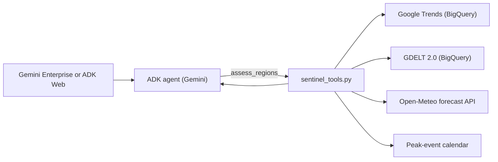

# Regional Radar

ADK agent that scores production-readiness risk for Google Cloud regions using public data. It returns a risk level, a score, the signal data, text charts and recommended actions for each region.

Runs on Vertex AI Agent Engine and can be registered in Gemini Enterprise. The agent is named `peak_sentinel` in code.

## Architecture



## Tools

| Tool | Description |
|---|---|
| `assess_regions(regions)` | Scores the given regions, or all regions when passed `["all"]`. Returns per-region signals, score, level, drivers, recommendations, charts and source errors. |
| `list_regions()` | Lists supported regions and their locations. |
| `bar_chart`, `trend_chart` | Render text charts. |

## Signals

| Signal | Source | Refresh |
|---|---|---|
| Demand | `bigquery-public-data.google_trends` top rising terms (US metros, 42 countries), matched against a retail term list | Weekly |
| Calendar | Fixed dates: Diwali, Singles Day, Black Friday, Cyber Monday, Christmas, Boxing Day, Lunar New Year | Static |
| Weather | Open-Meteo 7-day daily forecast at the region's location | Several times a day |
| Unrest | `gdelt-bq.gdeltv2.events_partitioned`, share of protest and material-conflict events, last 7 days vs prior 30 | Daily |

US regions use state-level GDELT data and fall back to country level when the state has fewer than 300 events.

## Scoring

| Signal | Elevated | Critical |
|---|---|---|
| Demand (share of areas with a rising retail term) | ≥ 5%: 15 pts. ≥ 20%: 30 pts | ≥ 40% |
| Calendar (days to next event) | ≤ 45: 10 pts. ≤ 14: 20 pts | n/a |
| Weather (7-day peak) | Gust ≥ 60 km/h, max ≥ 35 °C, min ≤ -10 °C, rain ≥ 40 mm, snow ≥ 5 cm: 20 pts | Gust ≥ 90, max ≥ 40, min ≤ -20, rain ≥ 100, snow ≥ 20: 40 pts |
| Unrest (7-day / 30-day ratio, ≥ 30 events) | ≥ 1.4: 20 pts | ≥ 2.0: 40 pts |

Level: **Critical** if score ≥ 60 or any signal is Critical. **Elevated** if score ≥ 20 or any signal is Elevated. Otherwise **Low**. Score is capped at 100.

## Implementation notes

- Scoring is done in Python, not by the model.
- BigQuery access uses fixed, parameterized queries. There is no free-form SQL tool.
- Each query sets `maximum_bytes_billed` to 20 GB.
- A failed source is marked `Unknown` and listed in `source_errors`. The other signals still return.
- A full scan makes one Open-Meteo request, one GDELT query and up to four Trends queries.
- Charts are monospaced text.

## Repository layout

```
app/
  agent.py                 Agent definition
  prompt.py                Instruction
  sentinel_tools.py        Signals, scoring, recommendations, tools
  charts.py                Text charts
scripts/
  readiness_report.py      Writes a markdown report for all regions (no LLM)
docs/
  readiness-assessment.md  Sample report from readiness_report.py
tests/unit/
  test_sentinel.py         Offline unit tests
```

## Setup

Requirements: a Google Cloud project with the Vertex AI and BigQuery APIs enabled, `uv`, and `gcloud` authenticated with `gcloud auth application-default login`.

`app/.env`:

```bash
GOOGLE_CLOUD_PROJECT=your-project-id
GOOGLE_CLOUD_LOCATION=us-east1
GOOGLE_GENAI_USE_VERTEXAI=1
GEMINI_MODEL=gemini-2.5-flash
```

Tests:

```bash
uv sync
uv run pytest -q tests/unit/test_sentinel.py
```

Report:

```bash
uv run python scripts/readiness_report.py docs/readiness-assessment.md
```

Local UI:

```bash
uv run adk web . --port 8501
```

Deploy:

```bash
make backend
make register-gemini-enterprise
```

The Agent Engine service account needs `roles/bigquery.user` and `roles/bigquery.dataViewer`.

## Supported regions

us-east1, us-east4, us-east5, us-central1, us-south1, us-west1, us-west2, us-west3, us-west4, northamerica-northeast1, northamerica-northeast2, southamerica-east1, europe-west1, europe-west2, europe-west3, europe-west4, europe-west9, asia-south1, asia-northeast1, asia-southeast1, australia-southeast1. Defined in `REGIONS` in `app/sentinel_tools.py`.

## Limitations

- Google Trends data covers only the top 25 rising terms per area per week.
- GDELT counts news coverage, and its geocoding varies by country.
- The retail term list and event calendar are maintained by hand.
- Weather uses one point per region.
- Signals describe conditions near a region. They do not indicate Google Cloud infrastructure health.
